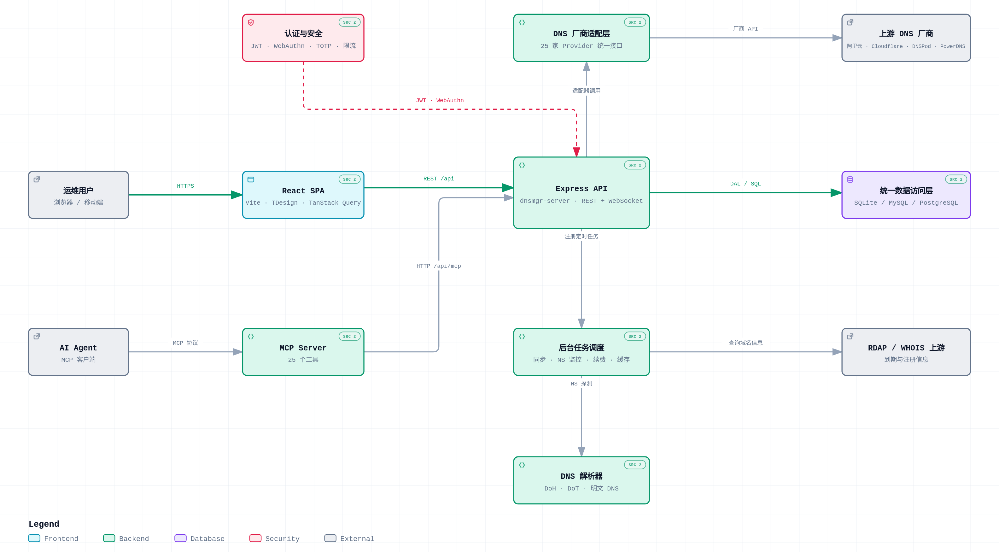

# HiDNS - DNS Aggregation Management Platform

> **原名**: DnsMgr (HiPm DnsMgr) | **现名**: HiDNS (HiPm DNS Aggregation Management Platform)
>
> A modern DNS aggregation management platform built with React + TailwindCSS (frontend) and Node.js + TypeScript (backend).

对于中国用户请看: [简体中文文档](README_zh.md)

## Repository
[](https://github.com/HiPM-Tech/HiDNS/blob/main/LICENSE)
[](https://github.com/HiPM-Tech/HiDNS/releases)

[](https://github.com/HiPM-Tech/HiDNS/issues)\
[](https://github.com/HiPM-Tech/HiDNS/stargazers)
[](https://github.com/HiPM-Tech/HiDNS/forks)\
[](https://github.com/HiPM-Tech/HiDNS/actions/workflows/release.yml)
[](https://github.com/HiPM-Tech/HiDNS/actions/workflows/docker-build.yml)

[](https://github.com/HiPM-Tech/HiDNS/actions/workflows/test-suite.yml)\
[](https://deepwiki.com/HiPM-Tech/HiDNS)
[![zread](https://img.shields.io/badge/Ask_Zread-_.svg?style=flat-square&color=00b0aa&labelColor=000000&logo=data%3Aimage%2Fsvg%2Bxml%3Bbase64%2CPHN2ZyB3aWR0aD0iMTYiIGhlaWdodD0iMTYiIHZpZXdCb3g9IjAgMCAxNiAxNiIgZmlsbD0ibm9uZSIgeG1sbnM9Imh0dHA6Ly93d3cudzMub3JnLzIwMDAvc3ZnIj4KPHBhdGggZD0iTTQuOTYxNTYgMS42MDAxSDIuMjQxNTZDMS44ODgxIDEuNjAwMSAxLjYwMTU2IDEuODg2NjQgMS42MDE1NiAyLjI0MDFWNC45NjAxQzEuNjAxNTYgNS4zMTM1NiAxLjg4ODEgNS42MDAxIDIuMjQxNTYgNS42MDAxSDQuOTYxNTZDNS4zMTUwMiA1LjYwMDEgNS42MDE1NiA1LjMxMzU2IDUuNjAxNTYgNC45NjAxVjIuMjQwMUM1LjYwMTU2IDEuODg2NjQgNS4zMTUwMiAxLjYwMDEgNC45NjE1NiAxLjYwMDFaIiBmaWxsPSIjZmZmIi8%2BCjxwYXRoIGQ9Ik00Ljk2MTU2IDEwLjM5OTlIMi4yNDE1NkMxLjg4ODEgMTAuMzk5OSAxLjYwMTU2IDEwLjY4NjQgMS42MDE1NiAxMS4wMzk5VjEzLjc1OTlDMS42MDE1NiAxNC4xMTM0IDEuODg4MSAxNC4zOTk5IDIuMjQxNTYgMTQuMzk5OUg0Ljk2MTU2QzUuMzE1MDIgMTQuMzk5OSA1LjYwMTU2IDE0LjExMzQgNS42MDE1NiAxMy43NTk5VjExLjAzOTlDNS42MDE1NiAxMC42ODY0IDUuMzE1MDIgMTAuMzk5OSA0Ljk2MTU2IDEwLjM5OTlaIiBmaWxsPSIjZmZmIi8%2BCjxwYXRoIGQ9Ik0xMy43NTg0IDEuNjAwMUgxMS4wMzg0QzEwLjY4NSAxLjYwMDEgMTAuMzk4NCAxLjg4NjY0IDEwLjM5ODQgMi4yNDAxVjQuOTYwMUMxMC4zOTg0IDUuMzEzNTYgMTAuNjg1IDUuNjAwMSAxMS4wMzg0IDUuNjAwMUgxMy43NTg0QzE0LjExMTkgNS42MDAxIDE0LjM5ODQgNS4zMTM1NiAxNC4zOTg0IDQuOTYwMVYyLjI0MDFDMTQuMzk4NCAxLjg4NjY0IDE0LjExMTkgMS42MDAxIDEzLjc1ODQgMS42MDAxWiIgZmlsbD0iI2ZmZiIvPgo8cGF0aCBkPSJNNCAxMkwxMiA0TDQgMTJaIiBmaWxsPSIjZmZmIi8%2BCjxwYXRoIGQ9Ik00IDEyTDEyIDQiIHN0cm9rZT0iI2ZmZiIgc3Ryb2tlLXdpZHRoPSIxLjUiIHN0cm9rZS1saW5lY2FwPSJyb3VuZCIvPgo8L3N2Zz4K&logoColor=ffffff)](https://zread.ai/HiPM-Tech/HiDNS)

## Features

- **Multi-provider Support**: Manage DNS records across 26 providers:
  - **Domestic (China)**: Aliyun (阿里云), DNSPod (腾讯云), Huawei Cloud (华为云), Baidu Cloud (百度云)
    Volcengine (火山引擎), JD Cloud (京东云), West Digital (西部数码), Qingcloud (青云)
    BT Panel (宝塔), Aliyun ESA (阿里云 ESA), Tencent EdgeOne (腾讯 EdgeOne), Rainyun (雨云), VPS8
  - **International**: Cloudflare, NameSilo, Spaceship, PowerDNS, DNS.LA, DNSHE, HiDNS, CaihongDNS (彩虹DNS聚合), Gcore

- **Advanced Features**:
  - WHOIS query with intelligent caching (registrar mode support)
  - Domain renewal management (automated renewal scheduling)
  - NS monitoring and failover (high availability保障)
  - API Token management (fine-grained permission control)
  - Cloudflare Tunnel integration
  - Multi-language support (Chinese/English/Japanese/Spanish)
  - OAuth2/OIDC single sign-on
  - WebAuthn/Passkeys passwordless login
  - TOTP two-factor authentication
  - Complete audit logging system
  - Security policies and login restrictions
  - Email notification and template management

- **Multi-user & Team Management**: Role-based access (admin/member), team-based domain sharing
- **Full DNS Record Management**: CRUD for all record types (A, AAAA, CNAME, MX, TXT, SRV, CAA, etc.)
- **Modern UI**: React 19 + TailwindCSS with responsive design
- **API Documentation**: Swagger UI at `/api/docs`
- **Extensible Architecture**: Abstract DNS interface makes adding new providers easy

## Provider Type & Alias Mapping

When creating/updating DNS accounts, the API normalizes lego-style provider names to internal provider types.

| Internal Type | Supported Aliases |
|---|---|
| `aliyun` | `aliyun`, `alidns` |
| `aliyunesa` | `aliesa` |
| `baidu` | `baiducloud` |
| `huawei` | `huaweicloud` |
| `huoshan` | `huoshan`, `volcengine` |
| `west` | `westcn` |
| `cloudflare` | `cloudflare` |
| `jdcloud` | `jdcloud` |
| `namesilo` | `namesilo` |
| `rainyun` | `rainyun` |
| `powerdns` | `powerdns`, `pdns` |
| `dnspod` | `dnspod`, `tencentcloud` |
| `tencenteo` | `tencenteo`, `edgeone` |
| `dnsla` | `dnsla` |
| `bt` | `bt` |
| `qingcloud` | `qingcloud` |
| `spaceship` | `spaceship` |
| `dnshe` | `dnshe` |
| `HiDNS` | `HiDNS` |
| `caihongdns` | `caihongdns` |
| `vps8` | `vps8` |
| `gcore` | `gcore` |

## Architecture

### Architecture Overview

<picture>
  <source media="(prefers-color-scheme: dark)" srcset="docs/architecture/hidns-architecture-dark.png">
  
</picture>

> **Interactive version** — pan/zoom, search, focus tracing, light/dark themes, presentation mode and PNG/SVG export:
> [`docs/architecture/hidns-architecture.html`](docs/architecture/hidns-architecture.html) (download and open it in a browser).

### System Architecture

```
HiDNS/
├── server/          # Node.js + TypeScript backend
│   └── src/
│       ├── lib/dns/ # DNS provider adapters (abstract interface)
│       ├── routes/  # REST API routes
│       ├── middleware/ # auth, errorHandler, rateLimit, requestLogger
│       ├── service/ # business services & schedulers
│       │   ├── whois/               # WHOIS submodule (lookup/checker/cache/scheduler)
│       │   ├── renewalScheduler.ts  # domain renewal scheduling
│       │   ├── nsMonitorJob.ts      # NS monitoring task
│       │   ├── serviceMonitorJob.ts # service monitor + dns_failover task
│       │   ├── taskManager.ts       # task manager (concurrency/timeout/dedupe)
│       │   ├── dns-provider-service.ts, audit.ts, token.ts, session.ts
│       │   └── systemState.ts       # single source of truth for init state
│       └── db/      # four-layer database architecture
│           ├── bal/                 # business adapter layer (business-adapter.ts, only SQL exit)
│           ├── dal/                 # abstraction layer (connection pool, builder, compiler, types)
│           ├── dl/                  # drivers (sqlite / mysql / postgresql, BaseDriver)
│           └── dsm/                 # declarative schema, reconciler, migrations, backup
└── client/          # React 19 + Vite 8 + TailwindCSS
     └── src/
         ├── app/      # app-shell, protected-shell, require-admin, realtime, nav
         ├── features/ # all page code lives here (api.ts + use-*.ts + page + tests)
         ├── ui/       # design-system primitives (Radix + CVA + tailwind-merge)
         ├── lib/      # http.ts (typed fetch + ensureOk), theme.tsx, format.ts
         ├── copy/     # Simplified-Chinese copy
         ├── components/ # ErrorBoundary only (no global toast)
         └── App.tsx   # route table declared in one place
```

### Database Architecture (Multi-Layer Design)

HiDNS implements a strict multi-layer database architecture:

```
Routes/Service Layer → Business Adapter Layer(BAL) → Core Layer(DAC) → Driver Layer(DL) → Database
                                        ↕
                           Declarative Schema Management(DSM)
```

**Layer 1: Business Adapter Layer** (`server/src/db/bal/`)
- Functional API: `query()`, `get()`, `execute()`, `insert()`, `run()`
- Business operation modules: 38 `*Operations` objects (`UserOperations`, `DnsAccountOperations`, …) — the full list is §数据库 7 of `root.ai.md`
- All database operations MUST go through this layer
- Automatic logging and performance monitoring

**Layer 2: Database Abstraction Layer** (`server/src/db/dal/`)
- Unified type definitions
- Connection manager (singleton pattern)
- Database configuration management
- Query builder & SQL compiler

**Layer 3: Driver Layer** (`server/src/db/dl/`)
- MySQL driver (connection pool)
- PostgreSQL driver (connection pool)
- SQLite driver (Node.js built-in `node:sqlite`)
- Common SQL compilation logic unified in `BaseDriver` base class

**Layer 4: Declarative Schema Management** (`server/src/db/dsm/`)
- Declarative Schema definitions (`complete-schema.ts`)
- Schema reconciler (auto-detect and sync table structure differences)
- Data migration runner (legacy system upgrades)
- Version management

### Database API Usage

```typescript
// ✅ Correct - Use business adapter functions
import { query, get, execute, insert, UserOperations } from '../db';

const user = await get<User>('SELECT * FROM users WHERE id = ?', [userId]);
const users = await query<User>('SELECT * FROM users WHERE status = ?', ['active']);
const id = await insert('INSERT INTO users (name, email) VALUES (?, ?)', [name, email]);

// Use business operation modules
const user = await UserOperations.getById(1);
```

See [ARCHITECTURE.md](ARCHITECTURE.md) for detailed architecture documentation.

## Quick Start

### Prerequisites
- Node.js >= 18
- pnpm

### Install Dependencies

```bash
pnpm install
```

### Development

#### Mode 1: Concurrent Start (Recommended for most users)

Start both frontend and backend with a single command (runs on separate ports):

```bash
# Start both server (port 3001) and client (port 5173) in parallel
pnpm dev
```

Access: http://localhost:5173

> First startup note: if the system is not initialized yet, open the setup wizard at `http://localhost:5173/setup` (or `http://localhost:3001/setup` in unified mode) to configure DB and create the first admin.

#### Mode 2: Separate Start (For advanced users)

Start frontend and backend independently in separate terminals:

```bash
# Terminal 1 - Backend only (port 3001)
cd server && pnpm dev

# Terminal 2 - Frontend only (port 5173)
cd client && pnpm dev
```

### Production Build

```bash
pnpm build
```

### Source Code - Unified Mode (Single Port)

Run both frontend and backend on the same port (3001) - backend serves static files:

```bash
# Step 1: Build frontend first
pnpm --filter client build

# Step 2: Start backend only (serves both API and frontend on port 3001)
cd server && pnpm dev
```

Access: http://localhost:3001

This mode is useful when you want:
- Only one port exposed
- Same behavior as Docker deployment
- Simpler reverse proxy configuration

### Docker Deployment

Docker deployment uses all-in-one mode (frontend + backend in single container).

#### Option 1: Use Pre-built Image (Recommended)

```bash
# Run with pre-built image from GitHub Container Registry
docker run -d \
  -p 3001:3001 \
  -v $(pwd)/data:/app/data \
  --name hidns \
  ghcr.io/hipm-tech/hidns:latest
```

Or use Docker Compose:

```bash
# Download compose file
curl -O https://raw.githubusercontent.com/HiPM-Tech/HiDNS/main/docker-compose.yml

# Start service
docker-compose up -d
```

#### Option 2: Build from Source

```bash
# Build and run
docker build -t hidns .
docker run -d \
  -p 3001:3001 \
  -v $(pwd)/data:/app/data \
  --name hidns \
  hidns
```

Access: http://localhost:3001

### Environment Variables

Copy `.env.example` to `.env` in the `server/` directory:

```bash
cp server/.env.example server/.env
```

| Variable | Default | Description |
|----------|---------|-------------|
| `PORT` | `3001` | Server port |
| `NODE_ENV` | `development` | Runtime environment |
| `JWT_SECRET` | unset | Base JWT secret; if unset, server falls back to an insecure default (set this in production) |
| `DB_PATH` | `./HiDNS.db` | SQLite database path |
| `DB_TYPE` | `sqlite` | Database type: `sqlite`, `mysql`, or `postgresql` |
| `DB_HOST` | - | Database host (for MySQL/PostgreSQL) |
| `DB_PORT` | - | Database port (for MySQL/PostgreSQL) |
| `DB_NAME` | - | Database name (for MySQL/PostgreSQL) |
| `DB_USER` | - | Database user (for MySQL/PostgreSQL) |
| `DB_PASSWORD` | - | Database password (for MySQL/PostgreSQL) |
| `DB_SSL` | `false` | Enable SSL for MySQL/PostgreSQL |

### JWT runtime secret rotation (important)

- JWT signing uses: `JWT_SECRET + runtime_secret` (from DB table `runtime_secrets`).
- A per-runtime secret is generated/stored automatically if missing.
- During setup, after creating the first admin, runtime secrets are rotated.
- Existing JWT tokens become invalid when runtime secret changes.

## Initialization & Security Notes

- `/api/init/*` endpoints are intended for pre-setup initialization.
- Once the system is initialized (DB ready + users exist), `/api/init/database` rejects re-initialization with `403`.
- Admin credentials are created by setup wizard/API (`/api/init/admin`), not by a fixed default account.

## API Documentation

After starting the server, visit: `http://localhost:3001/api/docs`

## Record Model Notes

- DNS records still expose the generic `line` field for backward compatibility.
- For Cloudflare, use provider-specific fields in request/response payloads:
  - `cloudflare.proxied`: proxy switch (`true` = proxied, `false` = DNS only)
  - `cloudflare.proxiable`: whether the current record type can be proxied
- Write precedence for Cloudflare create/update:
  - If `cloudflare.proxied` is provided, it is used.
  - Otherwise, fallback to `line` (`'1'` = proxied, `'0'` = DNS only).

## The DnsAdapter Contract

Registration steps are in **Adding New DNS Providers** below. Providers are directory-based adapters declared in `providers/registry.ts` — there is no `DnsHelper.ts` switch and no `DNS_PROVIDERS` map (that section of older docs is wrong).

The adapter must implement the `DnsAdapter` interface (`server/src/lib/dns/DnsInterface.ts`):

```typescript
interface DnsAdapter {
  check(): Promise<boolean>;
  getDomainList(...): Promise<PageResult<DomainInfo>>;
  getDomainRecords(...): Promise<PageResult<DnsRecord>>;
  addDomainRecord(...): Promise<string | null>;
  updateDomainRecord(...): Promise<boolean>;
  deleteDomainRecord(...): Promise<boolean>;
  setDomainRecordStatus(...): Promise<boolean>;
  // ...
}
```

## Tech Stack

**Backend:**
- Node.js ≥ 24.22.1 + TypeScript
- Express.js
- SQLite (Node.js built-in `node:sqlite`, requires Node 24), MySQL (mysql2), PostgreSQL (pg)
- JWT authentication
- Swagger/OpenAPI documentation
- node-cron / node-schedule: Task scheduling
- nodemailer: Email sending
- @simplewebauthn/server: WebAuthn support
- otplib: TOTP generation and verification
- HTTP client: built-in `fetch` via `server/src/lib/proxy-http.ts` (no axios)

**Frontend:**
- React 19 + TypeScript
- Vite 8
- TailwindCSS v3.4
- React Router 7
- @tanstack/react-query 5
- lucide-react (the only icon set; no UI component library)
- react-hook-form: Form management
- zod: Data validation
- date-fns: Date handling
- clsx / tailwind-merge: CSS class merging

## License

GPL-3.0 — see [LICENSE](LICENSE).

## Language Policy

HiDNS UI ships in **Simplified Chinese only**. The i18next stack and every `client/src/i18n/**` / `client/src/pages/**` file were removed in the 2026-10 frontend rebuild — there is no language selector, no `resources` map, and no translation keys to extend.

- User-facing copy lives in `client/src/copy/zh-CN.ts` and inside each `client/src/features/<domain>/` module.
- Adding a language is not a supported contribution path today; a reintroduced i18n framework would be an architecture change and is explicitly forbidden by `root.ai.md` §客户端架构.

See [`root.ai.md`](root.ai.md) §客户端架构 for the authoritative client rules.

## Adding New DNS Providers

Providers are class-based adapters under `server/src/lib/dns/providers/<provider>/` and are declared — not switched on. The authoritative steps live in [`root.ai.md`](root.ai.md) §DNS提供商适配器; short version:

1. **Implement the adapter**: `providers/<name>/adapter.ts` implementing `DnsAdapter` (`server/src/lib/dns/DnsInterface.ts`), plus `auth.ts` and `index.ts`. Extend `BaseAdapter` from `providers/common.ts`.
2. **Route HTTP through the proxy layer**: use `requestJson` / `requestXml` (`providers/http.ts`) or `fetchWithFallback`. Native `fetch` is forbidden — it hangs behind a proxy.
3. **Register the definition**: add the provider to `PROVIDERS` in `providers/registry.ts` (name, capabilities, config fields, `lineSource` + `defaultLine`, `capabilities.redirect`). Named-export the adapter class from `providers/index.ts`; `adapterFactory` in `registry.ts` does the wiring.
4. **Respect the adapter invariants**: real upstream `RecordId`, throwing `getRecordLines()` on failure, capability bits enforced at the call site (§DNS接口定义 2.1–2.3).
5. **Contract tests**: `server/src/lib/dns/__tests__/adapter-contract.test.ts` must pass — it checks `DEFAULT_LINE` against the registry `defaultLine`.
6. **No frontend edit needed**: the account form is generated from `ProviderConfigField[]`; there is no hard-coded provider list in the client.

---

## 🛡️ AI Censorship & Code Quality

HiDNS adopts a strict AI code review mechanism to ensure code quality and project standards.

### Code Review Standards

- **P0 Level** (Must Fix): Database standards, security vulnerabilities, functional defects
- **P1 Level** (Recommended Fix): Code quality, performance, layering violations (§数据库 2), missing log rate-limiting (§日志 9)
- **P2 Level** (Optional Optimization): Code comments, naming conventions, abstraction reuse

### Core Requirements

1. ✅ All database operations MUST go through the Business Adapter Layer
2. ✅ JWT authentication uses dual-key structure
3. ✅ Complete logging (requests, responses, errors, business operations)
4. ✅ OAuth2/OIDC standard support
5. ✅ Declarative schema (DSM) with automatic reconciliation, no ad-hoc DDL

### Documentation

- [Project Standards](root.ai.md) — **authoritative**: database layers, logging, routing, providers, client structure, gates, release process, review process
- [API Reference](docs/api.md) — **authoritative**: endpoints, parameters, auth, token permission mapping
- [Documentation Index](docs/README.md) — which doc is authoritative, which is historical
- [Architecture Overview](docs/architecture/overview.md) — explanatory, follows the two sources above

## Star History

<a href="https://www.star-history.com/?repos=HiPM-Tech%2FHiDNS&type=date&legend=top-left">
 <picture>
   <source media="(prefers-color-scheme: dark)" srcset="https://api.star-history.com/chart?repos=HiPM-Tech/HiDNS&type=date&theme=dark&legend=top-left" />
   <source media="(prefers-color-scheme: light)" srcset="https://api.star-history.com/chart?repos=HiPM-Tech/HiDNS&type=date&legend=top-left" />
   
 </picture>
</a>

## Community & Support

- **GitHub Repository**: https://github.com/HiPM-Tech/HiDNS
- **Telegram Group**: https://t.me/HiDNSManager
- **License**: GPL-3.0

## ☕ Sponsor

If you find HiDNS helpful, consider buying me a coffee! Your support keeps the project alive and motivated.

<p align="center">
  
  
</p>

<p align="center">
  <i>Reward Code &nbsp;&nbsp;&nbsp;&nbsp;&nbsp;&nbsp;&nbsp;&nbsp;&nbsp;&nbsp;&nbsp;&nbsp;&nbsp; Donation Code</i>
</p>

---

<p align="center">
  Made with ❤️ by HiPM Tech
</p>
